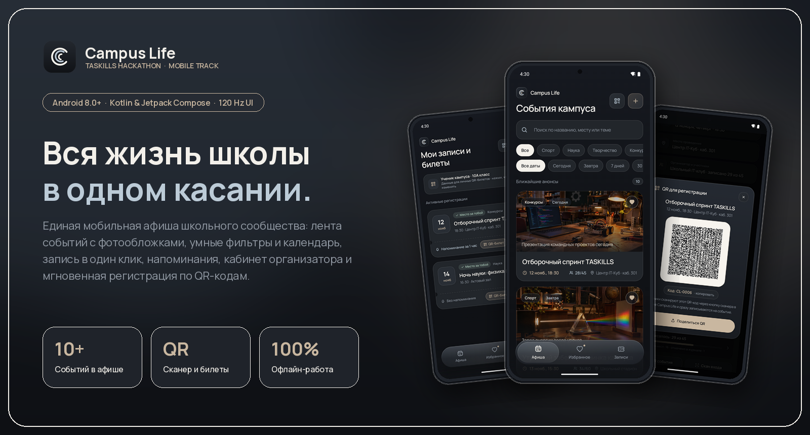
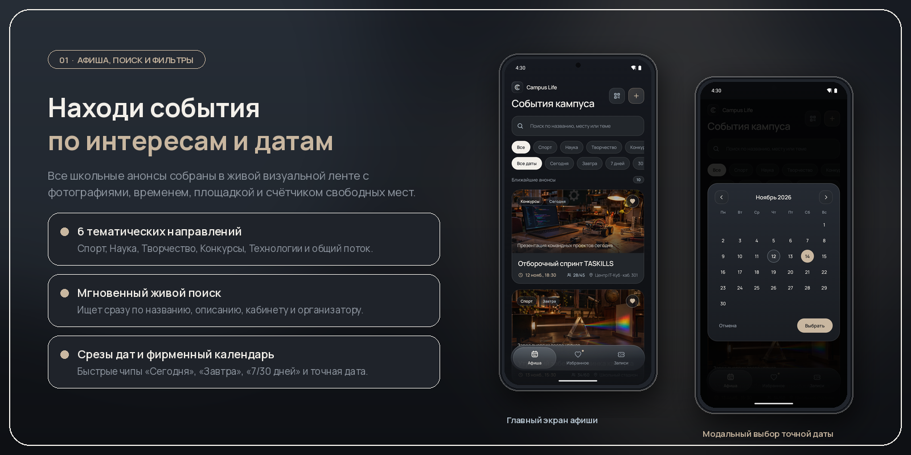
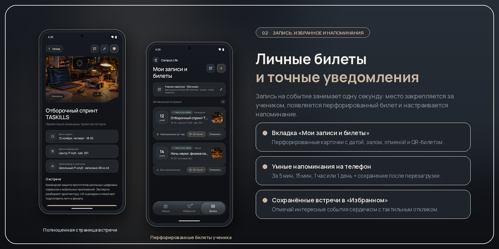
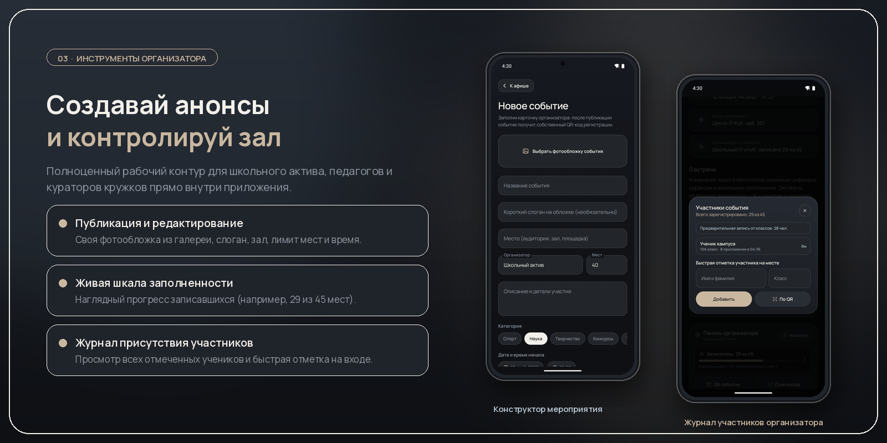
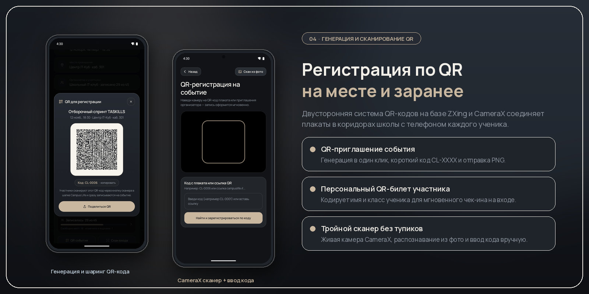
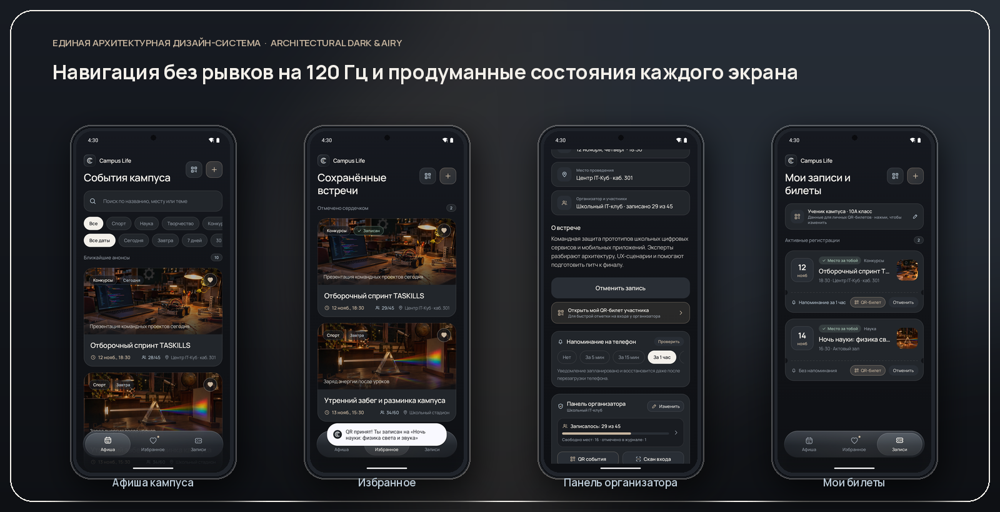

<div align="center">



<br />

# Campus Life

### Единая мобильная афиша мероприятий школьного сообщества
**Всероссийский хакатон по информационным технологиям «TASKILLS» · Трек «Мобильная разработка»**

<p align="center">
  <a href="https://github.com/Thebenua/portfolio-site/releases/download/v1.2.0/CampusLife-v1.2-release.apk">
    
  </a>
  <a href="https://github.com/Thebenua/portfolio-site/releases/download/v1.2.0/CampusLife-demo.mp4">
    
  </a>
  <a href="https://github.com/Thebenua/portfolio-site/releases/tag/v1.2.0">
    
  </a>
</p>

<p align="center">
  
  
  
  
  
</p>

<p align="center">
  <a href="#-визуальный-обзор-возможностей">Обзор функций</a> ·
  <a href="#-панорама-интерфейса">Экраны</a> ·
  <a href="#-видеодемонстрация-и-релиз">Демо и APK</a> ·
  <a href="#-соответствие-заданию-хакатона-taskills">Чек-лист TASKILLS</a> ·
  <a href="#-архитектура-и-стек-технологий">Архитектура</a> ·
  <a href="#-быстрый-запуск-и-сборка">Как запустить</a>
</p>

</div>

---

## О проекте

Школьники регулярно пропускают интересные лекции, кружки, спортивные турниры и олимпиады, потому что анонсы теряются в десятках разрозненных чатов и бумажных объявлениях, а организаторы недополучают участников.

**Campus Life** решает эту проблему в формате быстрого, полностью автономного нативного Android-приложения:
- **Для учеников** — наглядная лента событий с фотообложками, фильтрами по интересам и датам, записью в одно касание, персональными **QR-билетами**, разделом **«Избранное»** и системными **напоминаниями** на телефон.
- **Для организаторов** — встроенный конструктор новых мероприятий со своими фотографиями, редактирование анонсов, контроль заполненности зала (`записано X из Y`), генерация **QR-приглашений** для плакатов и **CameraX-сканер** для отметки участников на входе.

---

## Визуальный обзор возможностей

### 1. Афиша кампуса, живой поиск и умные фильтры

<p align="center">
  
</p>

- **10 предзаполненных событий** разных форматов (от отборочного спринта `TASKILLS` и научной ночи с лазерами до волейбольного кубка и акустического вечера) с фотообложками, временем, кабинетом и счётчиком свободных мест.
- **Мгновенный поиск** по названию, тексту описания, площадке проведения и имени организатора.
- **Фильтрация по интересам:** `Все`, `Спорт`, `Наука`, `Творчество`, `Конкурсы`, `Технологии`.
- **Фильтрация по датам:** быстрые срезы (`Сегодня`, `Завтра`, `7 дней`, `30 дней`) и кастомный модальный календарь для выбора **точной даты**.

<br />

### 2. Запись на встречи, перфорированные билеты, избранное и напоминания

<p align="center">
  
</p>

- **Полноценная карточка мероприятия:** крупная обложка, расписание, площадка, организатор, счётчик записавшихся и подробное описание программы.
- **Запись и отмена в один клик:** при записи проверяется наличие свободных мест, формируется персональный билет во вкладке **«Записи»** и открывается доступ к личному QR-билету.
- **Избранное с сохранением состояния:** кнопка с упругой spring-анимацией сердечка прямо в ленте и карточке события собирает понравившиеся анонсы во вкладку **«Избранное»**.
- **Системные напоминания (`AlarmManager` + `BootReceiver`):** выбор уведомления `За 5 мин`, `За 15 мин`, `За 1 час` или `За 1 день` с автоматическим восстановлением после перезагрузки смартфона и кнопкой **«Проверить»** для мгновенного теста уведомления в шторке Android.

<br />

### 3. Кабинет и инструменты организатора

<p align="center">
  
</p>

- **Создание и редактирование событий:** загрузка любой фотографии из памяти смартфона (копируется во внутреннее хранилище приложения и никогда не теряется), название, слоган, аудитория, организатор, лимит мест, категория и фирменные модальные пикеры даты и времени.
- **Живая аналитика заполненности:** визуальный индикатор занятых мест (`Записалось: 29 из 45`), остаток свободных мест и счётчик персональных отметок.
- **Журнал присутствия:** модальное окно со списком зарегистрированных учеников, временем и способом записи (`В приложении`, `QR-код`, `На входе`), а также ручным добавлением участников на месте.

<br />

### 4. Двусторонняя экосистема QR-кодов

<p align="center">
  
</p>

- **Генерация QR-кода мероприятия (`ZXing`):** каждое событие (включая только что созданные организатором) получает уникальный QR-код регистрации `campuslife://register?...` и короткий код `CL-XXXX`. Карточку QR в формате PNG можно сразу отправить в школьный чат или на печать через системное меню **«Поделиться»** (`FileProvider`).
- **Персональный QR-билет ученика:** кодирует профиль участника (имя и класс/команда) для быстрой отметки у организатора кнопкой **«Скан входа»**.
- **Встроенный сканер с 3 режимами работы:**
  1. Живое наведение камеры смартфона в реальном времени (**CameraX** + `ImageAnalysis`).
  2. Распознавание QR-кода со скриншота или фотографии из галереи (**«Скан из фото»**).
  3. Ввод короткого кода с плаката (`CL-0001`) или переход по системному deep-link `campuslife://...`.

---

## Панорама интерфейса

<p align="center">
  
</p>

Интерфейс построен на собственной дизайн-системе **Architectural Dark & Airy** ([`design/SYSTEM.md`](design/SYSTEM.md)): глубокий обсидиановый фон `#111317`, матовые графитовые поверхности `#22262B`, тёплый песочный акцент `#C9B7A0`, вариативная кириллическая типографика **Manrope**, кастомные векторные иконки с нулевыми аллокациями в кадре (`drawWithCache`) и парящая стеклянная нижняя капсула навигации с поддержкой **90 / 120 Гц** и планшетной двухколоночной сетки.

---

## Видеодемонстрация и релиз

Готовая сборка приложения и видеозапись демонстрации доступны как прямо в репозитории, так и в разделе **[GitHub Releases](https://github.com/Thebenua/portfolio-site/releases/latest)**:

| Материал | Описание | Ссылка |
| :--- | :--- | :--- |
| **Release APK (`v1.2`)** | Оптимизированная и сжатая R8 сборка для Android 8.0+ (`3.0 МБ`) | **[Скачать APK из релиза](https://github.com/Thebenua/portfolio-site/releases/download/v1.2.0/CampusLife-v1.2-release.apk)** · [`campuslife/CampusLife-preview.apk`](campuslife/CampusLife-preview.apk) |
| **Видеодемонстрация (`MP4`)** | Запись работы приложения и пользовательских сценариев | **[Скачать видео из релиза](https://github.com/Thebenua/portfolio-site/releases/download/v1.2.0/CampusLife-demo.mp4)** · [`campuslife/CampusLife-demo.mp4`](campuslife/CampusLife-demo.mp4) |

---

## Соответствие заданию хакатона TASKILLS

| № | Требование кейса «CampusLife» | Уровень | Статус и реализация в проекте |
| :-: | :--- | :---: | :--- |
| **1** | **Лента и карточка мероприятий** (фото, название, описание, дата, время, место) | Базовый | **Выполнено** — 10 демо-событий с фотообложками, адаптивная лента, полноценный экран деталей каждого события |
| **2** | **Поиск и фильтрация** (по названию, категориям и датам) | Базовый | **Выполнено** — живой поиск, категории (`Спорт`, `Наука`, `Творчество`, `Конкурсы`, `Технологии`), срезы дат + модальный календарь |
| **3** | **Запись на мероприятие** (записаться, отменить, видеть список своих записей) | Базовый | **Выполнено** — запись с контролем мест, отмена, вкладка «Записи» с перфорированными билетами и профилем участника |
| **4** | **Избранное** (добавление и удаление с сохранением) | Базовый | **Выполнено** — отметка сердечком в ленте и карточке, отдельная вкладка со счётчиком, полное сохранение на устройстве |
| **5** | **Напоминания** (настройка уведомлений о приближении события) | Базовый | **Выполнено** — слоты за 5 мин / 15 мин / 1 час / 1 день (`AlarmManager`), восстановление после перезагрузки (`BootReceiver`), мгновенная проверка |
| **6** | **Организаторы** (создание, редактирование и просмотр числа участников) | **Усложнение** | **Выполнено** — конструктор и редактор событий с выбором фото, шкала заполненности зала, модальный журнал и отметка участников |
| **7** | **QR-коды** (генерация QR для регистрации и регистрация через него) | **Усложнение** | **Выполнено** — генерация QR события и личного QR-билета (`ZXing`), шаринг PNG, живой сканер `CameraX`, скан из фото и deep-link |

---

## Архитектура и стек технологий

```text
campuslife-repository/
├── app/src/main/
│   ├── AndroidManifest.xml                  # Разрешения, FileProvider, Reminder/Boot receivers, deep-link campuslife://
│   ├── java/ru/campuslife/app/
│   │   ├── MainActivity.kt                  # Навигация без сброса скролла, главный экран, карточка встречи, уведомления
│   │   ├── CampusData.kt                    # Модели Event и AttendeeEntry, каталог событий, офлайн-хранилище CampusStorage
│   │   ├── CampusOrganizer.kt               # Конструктор/редактор событий, панель организатора, журнал участников, профиль
│   │   ├── CampusQr.kt                      # Генератор QR (ZXing), шаринг карточек, CameraX-сканер и декодер из галереи
│   │   ├── CampusComponents.kt              # Карточки афиши, перфорированные билеты, фильтр-чипы и пустые состояния
│   │   ├── CampusModals.kt                  # Кастомные модальные окна календаря и выбора времени
│   │   ├── FloatingNav.kt                   # Парящая стеклянная нижняя навигация с GPU-анимацией капсулы
│   │   ├── CampusImageCache.kt              # LruCache и фоновое декодирование обложек на Dispatchers.IO + режим 120 Гц
│   │   ├── CampusIcons.kt                   # Авторский набор векторных иконок на единой сетке 24×24
│   │   └── CampusTheme.kt                   # Палитра, типографика Manrope Variable и spring-параметры анимаций
│   └── res/                                 # WebP-обложки, шрифт Manrope Variable, адаптивные иконки и FileProvider paths
├── campuslife/
│   ├── CampusLife-preview.apk               # Готовый установочный Release APK
│   └── CampusLife-demo.mp4                  # Видеодемонстрация работы приложения
└── design/
    ├── SYSTEM.md                            # Спецификация дизайн-системы и брендинга
    ├── brand/                               # Логотипы, иконки и векторные знаки в SVG/PNG
    └── showcase/                            # Широкоформатные презентационные иллюстрации для README
```

---

## Быстрый запуск и сборка

### Способ 1. Установка готового APK на смартфон (за 30 секунд)

1. Скачайте **[`CampusLife-preview.apk`](https://github.com/Thebenua/portfolio-site/releases/latest)** из последнего релиза (или из папки [`campuslife/`](campuslife/CampusLife-preview.apk)) на устройство с **Android 8.0 (API 26)** или новее.
2. Откройте файл на телефоне и подтвердите установку пакета.
3. Запустите **Campus Life**:
   - на Android 13+ при первом включении напоминания разрешите показ уведомлений;
   - при открытии QR-сканера разрешите доступ к камере (либо используйте кнопку **«Скан из фото»** или короткий код события, например `CL-0001`).

### Способ 2. Сборка проекта из исходного кода

#### Системные требования
- **JDK 17**
- **Android Studio Ladybug / Koala** (или новее)
- **Android SDK 35**

#### Команды сборки в терминале
```bash
# Клонирование репозитория
git clone https://github.com/Thebenua/portfolio-site.git
cd portfolio-site

# Сборка отладочной версии (Debug APK)
./gradlew assembleDebug

# Сборка оптимизированной релизной версии с R8 (Release APK)
./gradlew assembleRelease
```

На **Windows (PowerShell / CMD)**:
```powershell
.\gradlew.bat assembleDebug assembleRelease
```

Собранные пакеты сохраняются в:
- `app/build/outputs/apk/debug/app-debug.apk`
- `app/build/outputs/apk/release/app-release.apk`

---

<div align="center">
  <sub>Разработано специально для Всероссийского хакатона по информационным технологиям <b>«TASKILLS»</b> · 2026</sub>
</div>
